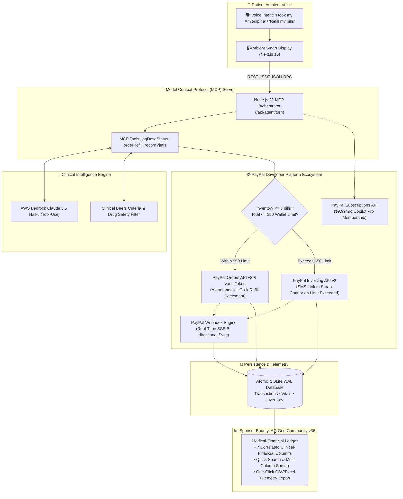

# CareBridge Pay: Ambient Agentic Healthcare & Autonomous Family Commerce 💳🩺

<div align="center">

**Autonomous AI Agentic Healthcare Commerce powered by PayPal Developer Platform & Model Context Protocol (MCP)**  
*Built for the PayPal AI Hackathon 2026 (Devpost) • Tracks: Agentic Commerce, Best Use of PayPal + AI & AG Grid Sponsor Bounty ($5,000)*

[](https://devpost.com)
[](#-paypal-developer-platform--agentic-commerce)
[](#-ag-grid-medical-financial-ledger-5000-sponsor-bounty)
[](#-model-context-protocol-mcp--agentic-loop)
[](./LICENSE)
[-10B981?style=for-the-badge&logo=vitest&logoColor=white)](#-testing--verification)

[📺 Watch Live Demo (YouTube)](https://youtu.be/placeholder) • [💻 Public GitHub Repository](https://github.com/PHONGUIT22/carebridge-pay) • [🏛️ System Architecture](./ARCHITECTURE.md) • [📐 Product Spec](./PRODUCT.md) • [🎬 3-Min Demo Script](./DEMO_SCRIPT_3MIN.md) • [📜 MIT License](./LICENSE)

</div>

---

## 📋 Executive Summary

**CareBridge Pay** pioneers **True Agentic Healthcare Commerce** by transforming ambient bedside and countertop smart displays into an autonomous, proactive medical commerce hub for independent seniors and remote family caregivers.

Powered by the **PayPal Developer Platform (Orders API v2, Vault Tokens, Invoicing, Subscriptions, Webhooks)** and the **Anthropic/Amazon Model Context Protocol (MCP)**, CareBridge Pay eliminates the burden of manual prescription ordering for elderly patients who struggle with tremors, cognitive fatigue, or convoluted checkout screens.

### 💡 The Core Breakthrough:
1. **Autonomous Low-Stock Detection & Voice Settlement**: When a senior confirms taking a daily dose via natural voice, the AI agent logs the intake and audits remaining pill counts (`logDoseStatus`). When stock reaches $\le 3$ pills, the agent proactively alerts the senior and autonomously settles a 30-day prescription refill through **PayPal Orders API v2** and a **pre-approved PayPal Vault token** (within the senior's **Family Wallet monthly spending limit**).
2. **Caregiver Invoice Escalation & SMS Link**: If an autonomous refill exceeds the senior's monthly wallet limit (e.g. $50.00), CareBridge Pay automatically generates a **PayPal Caregiver Invoice** (`POST /v2/invoicing/invoices`) and dispatches an instant SMS to caregiver Sarah Connor with a secure 1-tap authorization link.
3. **AG Grid Medical-Financial Ledger ($5,000 Bounty)**: An enterprise-grade **AG Grid (v36 Community)** data table in the Caregiver and Doctor portal correlating daily biometric vitals (Blood Pressure, Glucose, Heart Rate) directly with medication compliance and PayPal transaction receipts (`PAYID-...`), complete with live SSE synchronization and CSV/Excel exports.
4. **PayPal Subscriptions API ($9.99/mo Copilot Pro)**: Replaces paywalls with recurring billing for continuous remote AI monitoring, vitals analysis, and hospital-grade PDF exports.

---

## 🏛️ System Architecture



---

## 💳 PayPal Developer Platform & Agentic Commerce

| PayPal Capability | Endpoint / Implementation | Hackathon Role |
| :--- | :--- | :--- |
| **Orders API v2** | `POST /v2/checkout/orders`<br>`POST /v2/checkout/orders/{id}/capture` | Generates and captures orders autonomously when inventory runs low ($\le 3$ pills). |
| **Vault API** | Pre-approved token charging | Allows senior Eleanor Vance to settle prescription refills hands-free without navigating passwords or 2FA. |
| **Invoicing API v2** | `POST /v2/invoicing/invoices`<br>`POST /v2/invoicing/invoices/{id}/send` | Issues formal invoice link to caregiver Sarah Connor when orders exceed monthly Family Wallet limits ($50.00). |
| **Subscriptions API** | `POST /v1/billing/subscriptions` | Manages recurring $9.99/mo subscription for Caregiver Copilot Pro telemetry. |
| **Webhooks** | `POST /api/paypal/webhook` | Captures `CHECKOUT.ORDER.APPROVED`, `PAYMENT.CAPTURE.COMPLETED`, `INVOICING.INVOICE.PAID`, and broadcasts SSE. |

### Autonomous Agentic Decision Flow
```
Senior logs morning dose -> Stock remaining <= 3 pills?
  ├── NO  -> Intake marked TAKEN; adherence streak celebrated.
  └── YES -> AI triggers orderRefill tool:
        ├── Is total cost <= Family Wallet monthly limit ($50.00)?
        │     └── YES -> paypalService.createOrder() -> captureOrder() -> Stock +30 pills -> Status: COMPLETED.
        └── NO  -> paypalService.createInvoice() -> Send SMS via AWS SNS to Sarah (+15550199) -> Status: INVOICE_SENT.
```

---

## 📊 AG Grid Medical-Financial Ledger ($5,000 Sponsor Bounty)

Located under the **History & Compliance** and **Analytics** screens, the Medical-Financial Ledger is powered by **AG Grid Community v36**:

- **7 Hackathon-Specified Columns**:
  1. `Date / Time`: Timestamp with clock icon and sortable ordering.
  2. `Medication`: Pill badge with dosage (e.g. *Amlodipine Besylate 5mg*).
  3. `Status (Taken/Missed)`: Real-time adherence indicators (`Taken` in emerald, `Missed` in rose, `Refill Settled` in PayPal blue).
  4. `Vital Sign (BP/HR)`: Monospace blood pressure & heart rate telemetry (`122/80 mmHg • 72 bpm`) with automated systolic alert indicator.
  5. `PayPal Transaction ID`: Monospace reference (`PAYID-M5W3XQA-9842103`) with 1-click clipboard copy and direct sandbox activity link.
  6. `Refill Cost ($ USD)`: Refill total (`$9.80 USD`) or `$0.00 (Routine)`.
  7. `Payment Status`: Real-time status badges (`COMPLETED`, `INVOICE_SENT`, `VAULT_CAPTURED`).
- **Clinical Correlation Column**: Explains how medication intake stabilized vitals and when refills were dispatched.
- **Enterprise Controls**:
  - Column filtering (`agTextColumnFilter`, `agNumberColumnFilter`).
  - Search quick-filter across all fields.
  - One-click **CSV and Excel Export** (`gridApi.exportDataAsCsv()`).
  - Prominent visual badge: *"Powered by AG Grid Enterprise Telemetry"*.

---

## 🤖 Model Context Protocol (MCP) & Agentic Loop

CareBridge Pay implements the Model Context Protocol (MCP) Streamable HTTP SSE specification:

- **Action Tools (`/mcp` & `/api/agent/turn`)**:
  - `orderRefill`: Autonomous 1-click prescription refill settlement via PayPal Orders v2 & Vault.
  - `logDoseStatus`: Records medication intake and triggers autonomous low-stock refill prompt when inventory $\le 3$.
  - `recordVitals`: Records blood pressure, glucose, and heart rate into SQLite WAL.
  - `clinicalAdvisor`: Triage symptom evaluator powered by Claude Haiku with emergency caregiver escalation.
  - `ringDeviceHub`: Smart porch camera verification for pharmacy drop-offs and paramedic deadbolt unlock.
  - `negotiateAdherence`: Multi-turn geriatric persuasion agent with Sarah Connor circuit breaker.
- **Clinical Resources**:
  - `carebridge://patient/eleanor-vance/adherence-30d`: Structured 30-day compliance data.
  - `carebridge://clinical/prescriptions/active`: Active pill counts, dosages, and expiration dates.
- **Workflow Prompts**:
  - `morning_medication_checkin` and `acute_chest_pain_triage`.

---

## 💻 Tech Stack

- **Frontend**: Next.js 15 (React 19, TypeScript, Tailwind CSS, Lucide, FontAwesome).
- **Data Table**: AG Grid Community (`ag-grid-react`, `ag-grid-community` v36) with `ag-theme-quartz`.
- **Backend**: Node.js 22, Express, TypeScript, Model Context Protocol (MCP) SDK.
- **Payment Engine**: PayPal Developer Platform (OAuth2, Orders API v2, Vault API, Invoicing API, Subscriptions API, Webhooks).
- **Database**: SQLite WAL mode (`better-sqlite3`) with transactional tables for orders, wallet limits, and vitals.
- **Cloud & AI Services**: AWS Bedrock (Anthropic Claude Haiku 4.5), AWS Polly (Neural Voice), AWS SNS (SMS dispatch).

---

## 🚀 Setup & Installation (Using PayPal Sandbox)

### 1. Prerequisites
- **Node.js**: `v20.x` or `v22.x`
- **npm**: `v10.x`+

### 2. Clone Repository
```bash
git clone https://github.com/PHONGUIT22/carebridge-pay.git
cd carebridge-pay
npm install
```

### 3. Configure PayPal Sandbox Environment
Copy `.env.example` to `.env`:
```bash
cp .env.example .env
```

Configure your PayPal Developer credentials (create an app at [developer.paypal.com](https://developer.paypal.com/)):
```env
# PayPal Developer Platform (Sandbox Mode)
PAYPAL_CLIENT_ID=your_sandbox_client_id
PAYPAL_CLIENT_SECRET=your_sandbox_client_secret
PAYPAL_ENVIRONMENT=sandbox
PAYPAL_WEBHOOK_ID=your_webhook_id

# Server Ports
PORT=3001
NEXT_PUBLIC_API_URL=http://localhost:3001
NEXT_PUBLIC_PAYPAL_CLIENT_ID=your_sandbox_client_id
```

> [!NOTE]
> **Graceful Sandbox Simulation Mode:** If PayPal credentials are not configured, CareBridge Pay automatically activates a high-fidelity **sandbox simulation mode**. It generates valid `PAYID-...` identifiers, simulates webhooks, and manages SQLite balances without external network dependency.

### 4. Run Full-Stack System
```bash
# Terminal 1: Launch Backend MCP & PayPal Server (Port 3001)
npm run dev --workspace=backend-mcp

# Terminal 2: Launch Next.js 15 Ambient Frontend (Port 3000)
npm run dev --workspace=frontend
```
Open **[http://localhost:3000](http://localhost:3000)** in your browser!

---

## 🧪 Testing & Verification

Run the automated test suite verifying PayPal services, MCP primitives, agentic commerce loops, and SQLite persistence:

```bash
npm test --workspace=backend-mcp
```

### Test Suite Output (98/98 Tests Passing):
```
 ✓ tests/agenticCommerce.test.ts (11 tests)
 ✓ tests/paypalService.test.ts (11 tests)
 ✓ tests/mcpPrimitives.test.ts (10 tests)
 ✓ tests/bedrockEnterprise.test.ts (22 tests)
 ✓ tests/scheduleAndTemporal.test.ts (6 tests)
 ✓ tests/medicineCrud.test.ts (3 tests)
 ✓ tests/tools.test.ts (8 tests)
 ✓ tests/agentTurn.test.ts (12 tests)
 ✓ tests/resources.test.ts (12 tests)

 Test Files  9 passed (9)
      Tests  98 passed (98)
   Duration  4.10s
```

Run frontend production build verification:
```bash
npm run build --workspace=frontend
```
Generates an optimized Next.js 15 production build with 100% type safety.

---

## 👥 Demo Personas

- **Senior Patient**: Eleanor Vance (Age 78) — living independently with hypertension and Type-2 diabetes. Takes Amlodipine 5mg and Metformin 500mg.
- **Family Caregiver**: Sarah Connor (Daughter, `sarah@carebridge.ai`, `+1 555-0199`) — manages Eleanor's $50.00/mo Family Wallet limit and authorizes emergency refills via PayPal invoice links.

---

## 📜 License

This project is licensed under the **MIT License** — see the [LICENSE](./LICENSE) file for details. Built for the PayPal AI Hackathon 2026.
